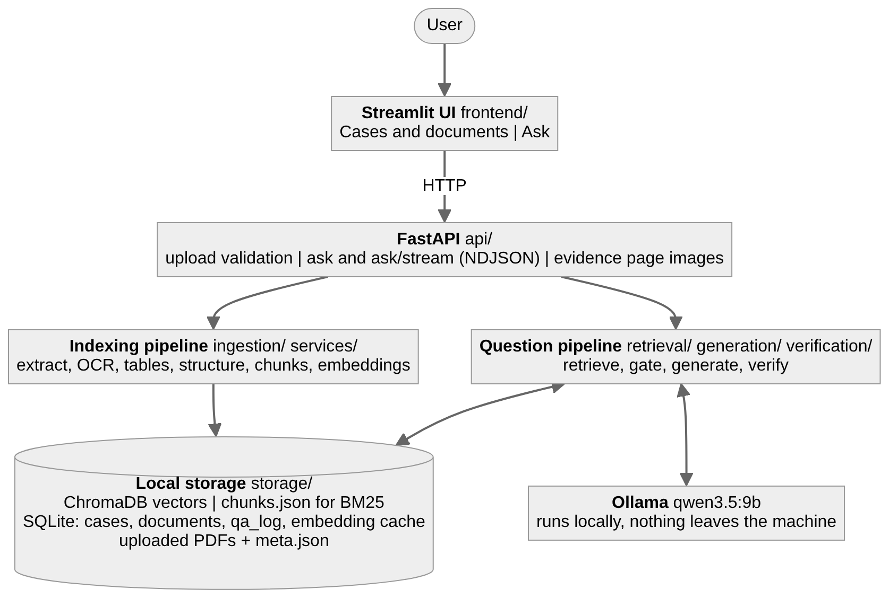

# Lexora AI

**Every answer has evidence.** An evidence-grounded analyst for legal PDFs (project *LexiSyncAI*, Deep Learning & GenAI, final assignment).
You upload 2-5 public legal documents, ask a question, and get a plain-language answer in which **every claim carries a document, a page,
a clause and a quote that the program has checked itself against the source**. When the documents do not contain enough evidence, the
system refuses and says what it searched, instead of guessing.

Everything runs on one machine: a local language model through Ollama, local embeddings and a local reranker. No document, question or
answer leaves it. This repository was started on 2026-11-04 as a step-by-step re-implementation of an earlier private prototype; its commit
history is the record of what was added and when.

## See it in 35 seconds


The documents are indexed, a question gets an answer whose citations the program has checked, and a question the documents cannot answer is
refused. The screens are recreated from the application's real copy. The animation above has no sound; download
[docs/lexora-demo.mp4](docs/lexora-demo.mp4) for the version with music (Music: Sascha Ende, [ende.app](https://ende.app/en), CC BY 4.0).

## For the reader: what was asked and what was done

The three tables follow the assignment text: the application flow (section 2), the core technical requirements (section 3) and the
deliverables (section 6). The optional features (section 4) are further down.

**Application flow (assignment section 2)**

| Step of the flow | How it works here |
|---|---|
| A user opens the application, creates a case and uploads 2-5 PDFs | *Cases and documents* page; at most 5 documents per case; `python -m scripts.download_sample_docs` fetches public PDFs from a URL |
| The system indexes them and shows the detected structure (pages, sections, tables, scanned pages flagged) | progress bar while indexing, then a per-page table (characters, text layer or OCR, tables, unusual-page flag) and the number of articles and clauses found |
| The user asks a question | *Ask* page |
| The answer is correct and combines passages, for example two clauses or a cap against a total | multi-hop retrieval (query decomposition) and a numeric comparison computed from the cited figures |
| Citations give page and clause, and the cited text and page are shown side by side | every claim lists its citations with six verification checks; a toggle shows the cited page with the quote highlighted next to them |
| A confidence badge: HIGH / MEDIUM / LOW / INSUFFICIENT EVIDENCE | computed from the verification results, not taken from the model |
| An explanation, including what to do when sources conflict | `reasoning_summary`, and conflicts between sources are shown, never silently resolved |
| A follow-up that the documents cannot answer: the system abstains and states which documents were searched | the sufficiency gate refuses before the model is called and lists the documents, the reason and the closest passages |

**Core technical requirements (assignment section 3)**

| Requirement | What was built | Evidence |
|---|---|---|
| §3.1 Ingestion and extraction: reading order (columns, headers, footers, footnotes), scanned pages flagged, clause-aware chunking | PyMuPDF extraction with page index and bounding box on every line, two-column order, header/footer/footnote handling, Tesseract OCR for image-only pages, legal structure detection (article, clause, point) and parent/child chunks | `ingestion/`, `tests/`, OCR evaluation in [docs/RESULTS.md](docs/RESULTS.md) |
| §3.2 Hybrid retrieval and reranking, recall@k per configuration | BM25 with a clause-number-aware tokenizer + dense MiniLM embeddings, merged by Reciprocal Rank Fusion, reranked by a cross-encoder, plus query decomposition | `retrieval/`; recall@1/3/5, full@5, precision@5 and MRR for five configurations under [Results](#results) |
| §3.3 Local LLM answers with page-level citations; the UI shows the cited page | Ollama (`qwen3.5:9b`), JSON output validated by Pydantic; six checks per citation; the page image with the quote highlighted | `generation/`, `verification/citation_validator.py`, `services/render.py` |
| §3.4 Abstention, and abstention accuracy on unanswerable questions | evidence-sufficiency gate (best rerank score and key-term coverage), thresholds calibrated on a separate dev set | `verification/evidence_checker.py`, `evaluation/calibrate.py`; abstention accuracy under [Results](#results) |
| §3.5 Evaluation: at least 15 questions (factual, multi-hop across two pages, at least 3 unanswerable); manual correctness, citation precision, abstention, latency; one mandatory comparison | 15 held-out questions (6 factual, 5 multi-hop, 4 unanswerable) with labelled evidence, a separate 14-question dev set, hand grading, **both** comparisons (dense vs hybrid, and no retrieval vs retrieval) | `evaluation/`; [Results](#results) and [docs/EVALUATION_ANALYSIS.md](docs/EVALUATION_ANALYSIS.md) |

**Deliverables (assignment section 6)**

| Deliverable | Where |
|---|---|
| Documentation | this README and [docs/](docs/): the one-page architecture diagram ([docs/overview.png](docs/overview.png)), [architecture.md](docs/architecture.md), [RESULTS.md](docs/RESULTS.md), [EXTENDED_FEATURES.md](docs/EXTENDED_FEATURES.md), [EVALUATION_ANALYSIS.md](docs/EVALUATION_ANALYSIS.md), [DOCKER_VERIFICATION.md](docs/DOCKER_VERIFICATION.md), [UI_VERIFICATION.md](docs/UI_VERIFICATION.md) |
| Codebase with an incremental commit history | this repository: every step, fix and measured result is its own commit |
| One-command run | `docker compose up --build`, `python run.py`, or `make run` |
| Pinned dependencies | every package in `requirements.txt` is pinned with `==`; the Docker image installs the same pins |
| Fixed seeds | `LEXORA_SEED=42` (also sent to Ollama with temperature 0.1) and seed 42 in every evaluation script |
| Tests | `python -m pytest -q`; the model, embeddings and reranker are replaced by fakes, so the suite runs offline in about a minute |

**Extended features (assignment section 4): eight of the eleven are implemented and evaluated**; see [Extended features](#extended-features).

## Headline results

Measured on the 15 held-out questions with the local `qwen3.5:9b` model. The tables below are generated from `evaluation/results/` by
`python -m evaluation.report`, so they cannot disagree with the full results further down. The manual grades are the author's own.

<!-- HIGHLIGHTS:START -->

| | No retrieval (the model alone) | Lexora AI (hybrid, rerank, verifier) |
|---|---|---|
| Answerable questions: mean score graded by hand (0 to 1) | 0.73 | 0.95 |
| Unanswerable questions handled correctly, graded by hand | 0.50 | 1.00 |
| Right decision to answer or to refuse (automatic, all 15 questions) | 0.73 | 1.00 |
| Citations that pass the validator | none | 0.97 |
| Citations whose quote lies in the labelled clause (region level) | none | 0.74 |
| Seconds per question (local model on a CPU) | 16 | 78 |

| Retrieval configuration | recall@5 | MRR |
|---|---|---|
| BM25 only | 0.85 | 0.75 |
| Dense only | 0.59 | 0.50 |
| Hybrid (BM25 + dense, RRF) | 0.83 | 0.73 |
| Hybrid + rerank | 0.83 | 0.80 |
| Hybrid + rerank + query decomposition | 0.89 | 0.86 |

<!-- HIGHLIGHTS:END -->

With 15 questions, one question moves a rate by 6-9 points: treat differences below about 10 points as noise. The complete tables, the
reading of the numbers and the limits of the evaluation are under [Evaluation](#evaluation).

## See it work in five minutes

1. Start it (Docker, or Python as in [Quick start](#quick-start)); open <http://127.0.0.1:8501>.
2. *Cases and documents*: create a case, upload the three public documents in `sample_docs/` (GDPR, ePrivacy Directive, Data Act).
3. *Ask* these three questions, taken from the held-out set. The expected answers are the labelled ones; the model's wording differs.

| Kind | Question | What the labels expect |
|---|---|---|
| factual | Within what time limit must a controller notify a personal data breach to the supervisory authority? | without undue delay and, where feasible, within 72 hours (GDPR Art. 33(1), p. 52) |
| multi-hop | Under the GDPR, what is the maximum fine a company can receive, and which kinds of violations trigger the higher fine? | up to EUR 20 million or 4 % of worldwide annual turnover for the higher tier, EUR 10 million or 2 % for the lower (Art. 83(5) and 83(4), pp. 82-83) |
| unanswerable | What is the maximum fine for very large online platforms under the Digital Services Act? | refusal: INSUFFICIENT EVIDENCE, because that regulation is not in the documents |

For each answer, open the evidence toggle to see the cited page with the quote highlighted. The unanswerable question is refused in about a
second, because the gate stops it before the model is called.

## How it works



The overview, the indexing diagram and the answering diagram, with the reasons behind each design decision, are in
[docs/architecture.md](docs/architecture.md).

1. **Retrieve** the best passages: BM25 and dense search, RRF fusion, cross-encoder rerank, sub-queries for compound questions.
2. **Gate**: if the best relevance score or the question-term coverage is too low, answer `INSUFFICIENT EVIDENCE` without calling the model,
   so the model never fills gaps from general knowledge.
3. **Generate** a JSON answer from the numbered passages `[E1] ...`; document text is treated as untrusted data.
4. **Verify** every citation independently: the document exists, the page exists, the clause exists, the quote occurs in the cited passage,
   the passage was retrieved for this question, and it supports the claim's numbers and key terms. If the draft fails, the model is told why
   and may rewrite it once.
5. **Confidence** (HIGH / MEDIUM / LOW) is computed from the verification results, not taken from the model.

Known limits: the validator checks lexical and numeric support, not logical entailment; an answer with some unverified claims is still shown
(flagged, with lower confidence); conflict detection is heuristic.

## Quick start

You need Python 3.11+ and [Ollama](https://ollama.com/download) with the model pulled once. Tesseract is only needed for scanned PDFs.

```bash
ollama pull qwen3.5:9b            # any other model works: set LEXORA_OLLAMA_MODEL
```

**Docker (one command).** Ollama keeps running on the host; the container reaches it. What was verified, and how, is in
[docs/DOCKER_VERIFICATION.md](docs/DOCKER_VERIFICATION.md).

```bash
docker compose up -d --build      # then open http://127.0.0.1:8501
python -m scripts.smoke_test --with-llm   # optional: checks the running container end to end
```

**Python.**

```bash
python -m venv .venv
source .venv/bin/activate         # Windows: .venv\Scripts\activate
pip install torch==2.15.0 --index-url https://download.pytorch.org/whl/cpu   # CPU-only PyTorch is much smaller
pip install -r requirements.txt
python run.py                     # starts the API and the UI and opens http://127.0.0.1:8501
```

**Make.** `make setup`, then `make run`; `make help` lists every target (`make test`, `make eval`, `make extended`, `make report`,
`make check`, `make docker-up`, ...).

In every command in this README, `sample_docs/*.pdf` works in any shell: the scripts expand wildcards themselves, so PowerShell and cmd need
no special handling. The two small Hugging Face models (embeddings and reranker, about 90 MB each) download on first use and are cached; after
that the project works offline. Scanned pages need Tesseract (Windows: `winget install --id UB-Mannheim.TesseractOCR -e`; set
`LEXORA_TESSERACT_CMD` if it is not in the default place; Debian/Ubuntu: `apt install tesseract-ocr`).

Command-line tools (no UI):

```bash
python -m scripts.inspect_pdf file.pdf                       # pages, scans, structure, chunk list
python -m scripts.search_pdf a.pdf b.pdf -q "..." --compare  # BM25, dense, hybrid, + rerank, + decomposition side by side
python -m scripts.ask_pdf contract.pdf -q "..."              # the full pipeline in the terminal
python -m scripts.ask_pdf contract.pdf -q "..." --no-retrieval   # the same model without documents
```

## Using the application

| Page | What it is for |
|---|---|
| Cases and documents | create a case, upload PDFs with a progress bar, see per-page extraction (characters, scan or text layer, OCR confidence, tables, **unusual-page flag**), preview a page next to its extracted text, re-index, delete |
| Ask | question, search mode, rerank on or off, number of passages, retrieval off for the baseline; answer with confidence, claims, citations, the six checks, comparisons and conflicts, and the evidence page with the quote highlighted (yellow) and the clause region outlined (blue) |
| Dashboard | counters, the latest questions, status of the API, Ollama, the model, OCR, embeddings and reranker |
| Evaluation | every measured result of this project in tables (read from `evaluation/results/`; nothing is computed in the browser) |
| Settings | the settings in force and the environment variable that changes each one (read-only) |

| Endpoint | Purpose |
|---|---|
| `GET /api/health`, `/api/status`, `/api/stats`, `/api/settings`, `/api/evaluation` | health, Ollama and OCR availability, counters, settings, result files |
| `POST /api/cases`, `GET/DELETE /api/cases/{id}` | cases |
| `POST /api/cases/{id}/documents` | upload (validated: `.pdf` name, `%PDF` header, size, encryption, duplicates) |
| `GET /api/jobs/{id}` | indexing progress |
| `GET /api/documents/{id}/info`, `/pages/{n}`, `/pages/{n}/image` | explorer and evidence viewer (images only, never the raw PDF) |
| `POST /api/cases/{id}/ask`, `/ask/stream` | answer (complete JSON, or newline-delimited events) |

The interactive API documentation is at <http://127.0.0.1:8000/docs>.

## Evaluation

```bash
python -m scripts.download_sample_docs                           # GDPR, ePrivacy Directive, Data Act -> sample_docs/
python -m evaluation.calibrate sample_docs/*.pdf --write-env     # thresholds from the DEV set -> .env
python -m evaluation.evaluate sample_docs/*.pdf --retrieval-only # about 1 minute, no LLM
python -m evaluation.evaluate sample_docs/*.pdf --gen-configs no_retrieval hybrid hybrid_noverify --export-grading
python -m evaluation.report                                      # the generated blocks of this README + docs/RESULTS.md
```

* **Provenance.** Both question sets were written for the earlier private prototype of this project and are reused here unchanged; the
  labels are re-checked against the PDFs by the tests.
* **Held-out set** `evaluation/dataset.json`: 15 questions (6 factual, 5 multi-hop, 4 unanswerable), each with an expected answer, key facts
  and the labelled evidence (document, page, clause, a snippet). `tests/test_dataset.py` proves every snippet is on its labelled page.
  **Dev set** `evaluation/calibration_set.json`: 14 different questions used ONLY by `evaluation.calibrate`; a test checks that the two sets
  do not overlap.
* **Mandatory comparisons**: dense vs hybrid retrieval (`recall@k`, `full@k`, `precision@5`, MRR, latency) and no-retrieval vs
  retrieval-enabled answers (key-fact correctness, citations verified, citation precision, abstention accuracy, false-abstention rate,
  latency, tokens). Fixed seed 42.
* LLM answers take about 70-80 s each on a CPU. Each one is cached in `evaluation/results/gen_cache.jsonl` (not committed) as soon as it
  exists, so an interrupted run resumes; changing any setting that affects answers invalidates the cache.
* **Human grading.** The "answer correct" number from the program is an automatic key-fact PROXY: it misses paraphrases and cannot judge a
  refusal. `--export-grading` writes `evaluation/results/manual_grades.csv`; read each answer, enter 1 / 0.5 / 0 (scale in the file
  `evaluation/grading.py`), then run the same command with `--apply-grades <file> --grader "<your name>"` (answers come from the cache, the
  model is not asked again). The report names who graded and flags incomplete grading. The ablation configuration `hybrid_noverify` is
  measured automatically and is not part of the hand-graded sheet.
* A failed answer is never cached; cached answers that used retrieval are tied to the exact index, so indexing again makes them unusable (the
  no-retrieval baseline is unaffected). A manual grade is kept only while the answer it was given to is unchanged. If answerable questions are
  refused after the model answered, the report prints a WARNING: read `refusal_stage`, `refusal_reason` and `verifier_note` in
  `generation_by_question.csv` before trusting the numbers.
* Outputs in `evaluation/results/`: `summary.md` (tables), `summary.json`, `retrieval_by_question.csv`, `generation_by_question.csv`,
  `meta.json` (models, library versions, thresholds, document hashes, git commit), `calibration.json`, and one `.md`/`.json` pair for each
  extended-feature evaluation. [docs/RESULTS.md](docs/RESULTS.md) gathers all of them on one page.

### Results

The block between the markers is written by `python -m evaluation.report` from `evaluation/results/`; do not edit it by hand. The run was made
on the working tree that became the commit "Use one query path everywhere"; `meta.json` records that commit's parent, because the run
happened before the commit was made.

<!-- RESULTS:START -->

Run 2026-11-11 17:59:35 UTC - model `qwen3.5:9b`, seed 42, 15 held-out questions (11 answerable).

#### Retrieval (answerable questions)

| Configuration | recall@1 | recall@3 | recall@5 | full@5 | precision@5 | mrr | latency_ms |
|---|---|---|---|---|---|---|---|
| BM25 only | 0.55 | 0.73 | 0.85 | 0.73 | 0.27 | 0.75 | 21 |
| Dense only | 0.36 | 0.50 | 0.59 | 0.45 | 0.18 | 0.50 | 1318 |
| Hybrid (BM25 + dense, RRF) | 0.55 | 0.59 | 0.83 | 0.64 | 0.25 | 0.73 | 16 |
| Hybrid + rerank | 0.64 | 0.80 | 0.83 | 0.73 | 0.27 | 0.80 | 1073 |
| Hybrid + rerank + query decomposition | 0.64 | 0.85 | 0.89 | 0.82 | 0.31 | 0.86 | 4084 |

`recall@k` = share of the required evidence items (document + clause) in the top k; `full@k` = share of questions whose evidence is ALL in the top k (strict for multi-hop).

| Category / configuration | recall@1 | recall@5 | full@5 |
|---|---|---|---|
| factual / BM25 only | 0.83 | 1.00 | 1.00 |
| multihop / BM25 only | 0.20 | 0.67 | 0.40 |
| factual / Dense only | 0.67 | 0.83 | 0.83 |
| multihop / Dense only | 0.00 | 0.30 | 0.00 |
| factual / Hybrid (BM25 + dense, RRF) | 0.83 | 1.00 | 1.00 |
| multihop / Hybrid (BM25 + dense, RRF) | 0.20 | 0.63 | 0.20 |
| factual / Hybrid + rerank | 1.00 | 1.00 | 1.00 |
| multihop / Hybrid + rerank | 0.20 | 0.63 | 0.40 |
| factual / Hybrid + rerank + query decomposition | 1.00 | 1.00 | 1.00 |
| multihop / Hybrid + rerank + query decomposition | 0.20 | 0.77 | 0.60 |

#### Generation

| | no_retrieval | hybrid | hybrid_noverify |
|---|---|---|---|
| Answer correct, automatic key-fact PROXY (answerable) | 0.55 | 0.82 | 0.82 |
| Citations verified by the validator | - | 0.97 | 0.97 |
| Citation precision vs labelled evidence | - | 0.74 | 0.74 |
| Claims shown that the validator does not verify | - | 0.03 | 0.03 |
| Answers shown with at least one such claim | - | 0.09 | 0.09 |
| Abstention accuracy (all questions) | 0.73 | 1.00 | 1.00 |
| False-abstention rate (answerable refused) | 0.00 | 0.00 | 0.00 |
| Correct-abstention rate (unanswerable refused) | 0.00 | 1.00 | 1.00 |
| Mean retrieval + rerank time (s) | 0.00 | 3.63 | 3.41 |
| Mean generation time (s) | 16.08 | 73.89 | 69.18 |
| Mean total time (s) | 16.15 | 77.58 | 72.66 |
| Mean completion tokens | 95 | 482 | 453 |
| Answers that failed with an error | 0 | 0 | 0 |

The correctness row is an AUTOMATIC proxy (every key fact occurs in the answer); it misses paraphrases. It is not a human judgement. Grade the answers yourself with `--export-grading` / `--apply-grades`.

#### Citation precision at region level

Configuration `hybrid`, 34 emitted citations. A citation is a REGION hit when the quote it points at lies inside the labelled clause on the page (see `evaluation/region_eval.py`).

| Measure | Value |
|---|---|
| Quote found on the cited page (can be drawn) | 0.97 |
| Page-level precision | 0.85 |
| Region-level precision | 0.74 |
| Region-level precision, of the located quotes | 0.76 |
| Citations on the right page but outside the labelled region | 4 |

#### Manual grades

Graded by: **Sravan** (file `manual_grades.csv`). Scale: answerable: 1 correct and complete, 0.5 partly correct, 0 wrong/ungrounded/unjustified refusal; unanswerable: 1 correctly says the documents do not contain it, 0 answers from outside knowledge.

| | no_retrieval | hybrid |
|---|---|---|
| Answers graded | 15 / 15 | 15 / 15 |
| Answerable: mean score (1 / 0.5 / 0) | 0.73 | 0.95 |
| Answerable: strictly correct (grade 1) | 0.55 | 0.91 |
| Unanswerable: handled correctly | 0.50 | 1.00 |
| All questions: behaviour correct | 0.53 | 0.93 |

#### Reading the numbers

* **Retrieval configurations.** recall@5 is 0.59 for dense only, 0.85 for BM25 only and 0.83 for hybrid (MRR 0.50, 0.75, 0.73). The weakest configuration on recall@5 is "Dense only". With 11 answerable questions, differences below about 0.10 are noise.
* **Reranking** raises recall@3 (0.59 to 0.80), leaves unchanged recall@5 (0.83 to 0.83) and raises MRR (0.73 to 0.80); the retrieval latency goes from 16 ms to 1073 ms. The gate and the confidence use the reranker's score, which is why it stays in the pipeline either way.
* **Query decomposition** raises full@5 (0.73 to 0.82) and multi-hop full@5 (0.40 to 0.60). It was designed after looking at multi-hop failures of a similar prototype, so any gain here is optimistic.
* **Retrieval against no retrieval, graded by hand (Sravan).** Answerable questions score 0.95 with retrieval and 0.73 without; unanswerable questions are handled correctly 1.00 against 0.50. The price is time: 78 s per question against 16 s.
* **Citations.** 0.97 of the emitted citations pass the validator; citation precision against the labelled evidence is 0.74, so 26% of the cited passages are not among the labelled evidence items (they may be valid alternatives; that is not examined). At region level the precision is 0.74 (page level 0.85); 4 citation(s) are on the right page but outside the labelled region.
* **False abstentions.** The hybrid configuration refused 0 of 11 answerable questions. See the diagnostics section of docs/RESULTS.md for the reason.
* **Without the verifier** 3% of the claims shown are not verified, against 3% with it; the false-abstention rate is 0.00 without and 0.00 with the verifier; mean time 73 s and 78 s.

<!-- RESULTS:END -->

### Limits of the evaluation

* 15 questions: one question moves a rate by 6-9 points, so differences below about 10 points are noise.
* The dev set has 14 questions, so the calibrated thresholds are approximate.
* The automatic correctness proxy is not a human judgement; report the manual grades, and say who graded.
* Query decomposition was added after looking at multi-hop failures of a similar prototype, so its gain on this set is optimistic.
* The citation validator checks lexical and numeric support, not logical entailment.
* The thresholds of the sufficiency gate were calibrated on EU legal texts. Other kinds of documents have not been measured.
* The extended-feature evaluations use small or synthetic ground truths (see [docs/EXTENDED_FEATURES.md](docs/EXTENDED_FEATURES.md)); they show
  what works and where it stops, they are not benchmarks.
* A post-hoc analysis of the one false abstention found earlier is in [docs/EVALUATION_ANALYSIS.md](docs/EVALUATION_ANALYSIS.md).

## Extended features

Eight of the eleven optional features of the assignment are implemented and have an evaluation; three are not. Details, how to reproduce each
result, and the limits are in [docs/EXTENDED_FEATURES.md](docs/EXTENDED_FEATURES.md).

| # | Feature | Status | Evidence |
|---|---|---|---|
| 1 | OCR for scanned pages | implemented | OCR accuracy on degraded scans of real pages and the fallback without OCR: `evaluation/ocr_eval.py` |
| 2 | Table extraction | implemented | cell accuracy against a hand-written ground truth, including the cases it cannot read: `evaluation/table_eval.py` |
| 3 | Figure reading with a vision model | **not implemented** | |
| 4 | Bounding-box citations on the page image | implemented | the evidence viewer; precision at region level: `evaluation/region_eval.py` |
| 5 | Planner + verifier agent loop | implemented | the retry log (a rejected draft, the reasons, the rewrite) in every answer |
| 6 | Fine-tuned reranker or embedder | **not implemented** | |
| 7 | Ablation table | implemented | with and without the verifier (`hybrid_noverify`), text only against text + tables (`evaluation/ablation_tables.py`); no figures row |
| 8 | Autoencoder component | implemented | page-anomaly detector with a baseline comparison: `ingestion/page_anomaly.py`, `evaluation/page_anomaly_eval.py` |
| 9 | Multi-document cross-referencing | implemented | numeric comparison and conflict detection: `verification/conflict_detector.py` and its tests |
| 10 | Public deployment | **not implemented** | the system needs a local Ollama; Docker is provided instead |
| 11 | Latency and cost report | implemented | `evaluation/latency_report.py` and two measured optimisations (the sufficiency gate, the embedding cache) |

## Reproducibility

* **One command:** `python run.py`, `make run`, or `docker compose up --build`.
* **Pinned dependencies:** every package in `requirements.txt` is pinned with `==`; the Docker image installs the same pins.
* **Fixed seeds:** `LEXORA_SEED=42` (also sent to Ollama with temperature 0.1), seed 42 in every evaluation script.
* **Tests:** `python -m pytest -q`. The language model, embeddings and reranker are replaced by fakes, so the suite runs offline in about a
  minute; the few tests that need the real models or Tesseract are skipped when those are not installed.
* **Self-check before handing in:** `python -m scripts.check_submission` lists what is still open (pins, placeholders, results out of date,
  unpushed commits, ...).

## Project layout

The project folder holds the modules directly and every module imports the others by plain name (`from config import get_settings`).
Run everything from the project folder (`python run.py`, `python -m scripts.<name>`, `python -m evaluation.<name>`, `python -m pytest`);
the folder can have any name. `storage/` (uploaded files, indexes, database) and `.env` live inside the project folder.

```text
├── run.py                      # Start API + UI together
├── main.py                        # API entry point
├── app.py                         # Streamlit entry point
│
├── config.py                   # Application settings
├── schemas.py                     # Shared data models
├── textutil.py                    # Text and legal-language utilities
│
├── api/
│   ├── __init__.py
│   ├── app.py                     # FastAPI application
│   └── routes.py                  # REST endpoints
│
├── frontend/
│   ├── __init__.py
│   └── views/
│       ├── __init__.py
│       ├── dashboard.py           # Dashboard
│       ├── cases.py               # Cases and documents
│       ├── chat.py                # Ask Lexora
│       ├── evaluation.py          # Evaluation interface
│       └── settings.py            # Application settings
│
├── ingestion/
│   ├── __init__.py
│   ├── pdf_parser.py              # PDF validation and extraction
│   ├── ocr.py                     # Scanned document OCR
│   ├── table_extractor.py         # Table extraction
│   ├── structure_detector.py      # Legal structure detection
│   ├── chunker.py                 # Clause-aware chunking
│   └── page_anomaly.py            # Unusual-page detection
│
├── retrieval/
│   ├── __init__.py
│   ├── bm25.py                    # Keyword retrieval
│   ├── embeddings.py              # Local embeddings
│   ├── vector_store.py            # ChromaDB
│   ├── hybrid.py                  # Hybrid retrieval
│   └── reranker.py                # Cross-encoder reranking
│
├── generation/
│   ├── __init__.py
│   ├── answer_generator.py        # Answer generation pipeline
│   └── ollama_client.py           # Local LLM connection
│
├── verification/
│   ├── __init__.py
│   ├── evidence_checker.py        # Evidence sufficiency
│   ├── citation_validator.py      # Citation validation
│   └── conflict_detector.py       # Conflicts and numeric checks
│
├── services/
│   ├── __init__.py
│   ├── indexer.py                 # Document indexing
│   ├── db.py                      # SQLite database
│   ├── jobs.py                    # Background jobs
│   └── render.py                  # Highlighted evidence rendering
│
├── evaluation/
│   ├── __init__.py
│   ├── evaluate.py                # Evaluation runner
│   ├── metrics.py                 # Evaluation metrics
│   ├── grading.py                 # Human grading
│   ├── calibrate.py               # Threshold calibration
│   ├── diagnostics.py             # Gate diagnostics
│   ├── region_eval.py             # Region-level citation evaluation
│   ├── ocr_eval.py                # OCR evaluation
│   ├── table_eval.py              # Table evaluation
│   ├── page_anomaly_eval.py       # Anomaly detection evaluation
│   ├── ablation_tables.py         # Table ablation study
│   ├── latency_report.py          # Latency and cost
│   ├── bench_indexing.py          # Indexing benchmark
│   └── report.py                  # Results report generation
│
├── scripts/
│   ├── __init__.py
│   ├── smoke_test.py              # End-to-end smoke test
│   └── check_submission.py        # Submission readiness
│
├── tests/                         # Automated tests
│
├── docs/
│   ├── architecture.md            # Architecture documentation
│   └── RESULTS.md                 # Evaluation results
│
├── sample_docs/                   # Public EU evaluation documents
│
├── storage/                       # Runtime data, created on first use (not source code, not committed)
│   ├── cases/                     # per case: uploaded PDFs, extracted text, chunks.json
│   ├── chroma/                    # ChromaDB vectors
│   ├── cache/                     # embedding cache (SQLite)
│   └── lexora.db                  # cases, documents, question log
│
├── .env                           # Local environment configuration
├── .env.example                   # Configuration template
├── requirements.txt               # Pinned dependencies
├── Dockerfile
├── docker-compose.yml
└── Makefile
```

## Troubleshooting

| Symptom | Fix |
|---|---|
| The sidebar says "API offline" | start it: `python main.py` (or use `python run.py`, which starts both) |
| "Ollama offline" or the model is "not pulled" | `ollama serve`, then `ollama pull qwen3.5:9b`; the Dashboard shows what is installed |
| Every question is refused as insufficient evidence | read the reason under the answer (score and missing terms). If the documents were indexed by an older version the application says so and tells you to re-index; `Cases and documents > Re-index` fixes it |
| Scanned pages are flagged but not read | install Tesseract (see Quick start); the Dashboard shows "Tesseract OCR" in green when it is found; then re-index |
| The first answer is slow | the model is loaded into memory on first use; keep Ollama running (`OLLAMA_KEEP_ALIVE=30m`). About 70 s per answer on a CPU is normal |
| `LEXORA_*` setting has no effect | check the spelling against the Settings page; restart the application; re-index after changing chunking, embedding or OCR settings |
| Port 8000 or 8501 is in use | `API_PORT=8001 UI_PORT=8502 python run.py` |
| Docker cannot reach Ollama | see the troubleshooting table in [docs/DOCKER_VERIFICATION.md](docs/DOCKER_VERIFICATION.md) |
| Windows: `make` is not found | every `make` target is a one-line command written in the Makefile; run that command |

## Limitations

* A small hand-written vocabulary (`retrieval/synonyms.py`) adds the document's own wording to colloquial terms and abbreviations in a
  question (vans, EN-DE, ZLEV, ablation, GDPR, ...). It was written while testing question answering on documents other than the
  evaluation set, it applies to every question, and it is a patch for known cases, not a general solution to vocabulary mismatch. The same
  testing led to a stricter number check in the citation validator, a better table extractor and OCR repair, and one extra rule in the
  prompt; all evaluation numbers on this page were measured with all of these in place.
* Only digital and OCR-readable text is searched; figures and charts are not read (no vision model). Tables are found only when they are
  drawn with ruling lines (a table with horizontal rules only, or none, is read as ordinary text).
* The citation validator checks that a quote exists, was retrieved and shares numbers and key terms with the claim. It does not prove logical
  entailment, and it does not require that every sentence of an answer has a citation.
* The cross-encoder (`ms-marco-MiniLM`) can give a low score to a relevant passage; the gate then refuses a question that the documents do
  answer. The thresholds were calibrated on EU legal texts only.
* A 9B model on a CPU takes about 70-80 s per answer.
* The language of the documents and questions is English; the OCR language is a setting.
* Conflict detection and numeric comparison are heuristic; they show what they found and do not resolve it.

## Privacy and security

* Documents, embeddings and prompts stay on this machine. The API listens on `127.0.0.1`; the Docker ports are published on `127.0.0.1` only.
* An uploaded PDF is never served back as a file, only as rendered page images. Uploads are validated (extension, `%PDF` header, size limit,
  encryption, duplicates) and a rejected upload leaves nothing behind.
* Text inside a PDF is passed to the model as delimited, untrusted data; the validator still rejects any claim that is not supported by a
  retrieved passage, so an injected instruction cannot create a verified citation.
* No secrets are stored in the code; settings come from environment variables or a `.env` file that is not committed. The container runs as
  an unprivileged user and Streamlit sends no usage statistics.

## Documentation index

| Document | Content |
|---|---|
| [docs/architecture.md](docs/architecture.md) | the three diagrams, where each step lives, and the design decisions |
| [docs/RESULTS.md](docs/RESULTS.md) | every measured result on one page, generated from `evaluation/results/` |
| [docs/EXTENDED_FEATURES.md](docs/EXTENDED_FEATURES.md) | the eleven optional features: status, evidence, how to reproduce, limits |
| [docs/EVALUATION_ANALYSIS.md](docs/EVALUATION_ANALYSIS.md) | who graded and how, the false abstention, what the numbers do and do not show |
| [docs/DOCKER_VERIFICATION.md](docs/DOCKER_VERIFICATION.md) | what was verified in Docker and how |
| [docs/UI_VERIFICATION.md](docs/UI_VERIFICATION.md) | what was checked in a real browser, and a checklist |
