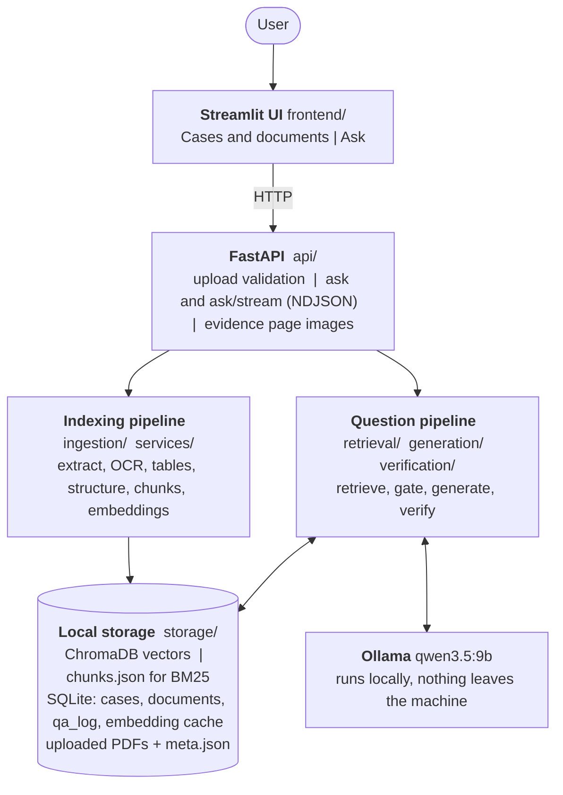
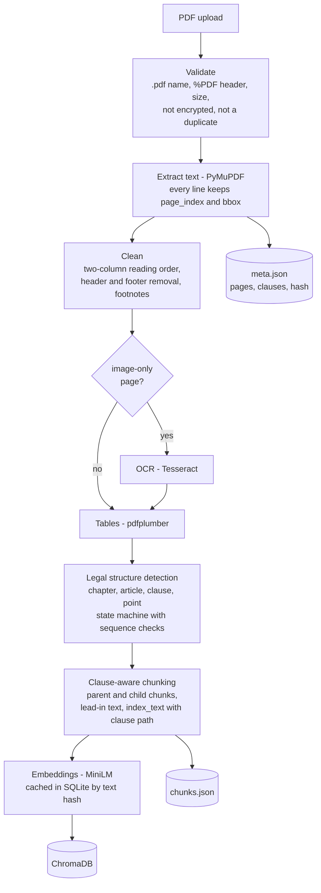
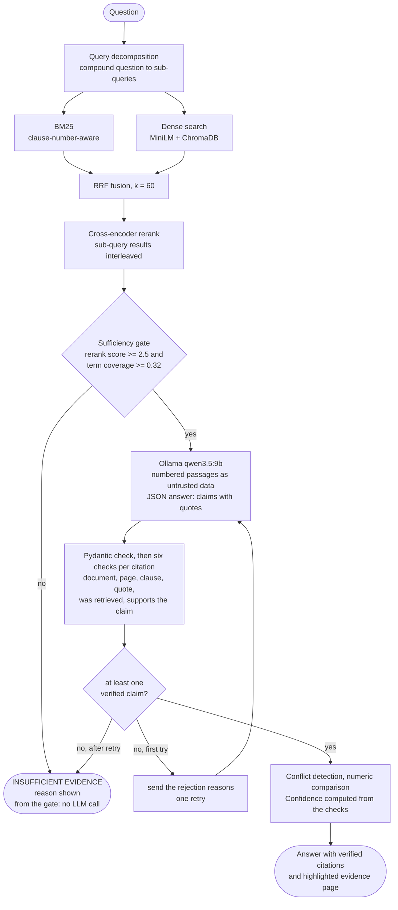

# Architecture

Everything runs on one machine: the browser talks to a Streamlit UI, the UI talks to a FastAPI backend, and the backend
uses local models (embeddings, reranker, Ollama). No document or question leaves the machine.

Pictures: [overview.png](overview.png), [indexing.png](indexing.png), [question.png](question.png) (rendered from the
`.mmd` sources next to them; the diagrams below are the same text and are drawn by GitHub).

## 1. Overview

## 2. Indexing: from a PDF to searchable, citable chunks

Every line keeps its page index and bounding box from the first step on. That is what lets an answer cite a page and
clause and lets the UI draw the quote on the page image.

## 3. Answering: retrieve, gate, generate, verify

## Where each step lives

| Step | Module | Notes |
|---|---|---|
| Upload checks | `api/routes.py`, `ingestion/pdf_parser.py` | name, `%PDF` header, size, encryption, duplicates |
| Text extraction, reading order, headers and footers | `ingestion/pdf_parser.py`, `ingestion/cleaning.py` | PyMuPDF; two columns; footnotes |
| OCR, tables | `ingestion/ocr.py`, `ingestion/table_extractor.py` | Tesseract for image-only pages; pdfplumber |
| Legal structure, chunking | `ingestion/structure_detector.py`, `ingestion/chunker.py` | article / clause / point path stored on every chunk |
| Embeddings, vector store | `retrieval/embeddings.py`, `retrieval/vector_store.py` | MiniLM, SQLite cache, ChromaDB (cosine) |
| BM25, fusion, rerank, decomposition | `retrieval/bm25.py`, `retrieval/hybrid.py`, `retrieval/reranker.py` | RRF k = 60; cross-encoder rerank |
| Sufficiency gate | `verification/evidence_checker.py`, `verification/abstention.py` | thresholds in `config.py` / `.env` |
| Generation | `generation/answer_generator.py`, `ollama_client.py`, `prompts.py` | JSON output, one verifier retry |
| Citation validation | `verification/citation_validator.py` | six checks per citation |
| Conflicts, numeric comparison | `verification/conflict_detector.py` | heuristic |
| Background jobs, storage | `services/jobs.py`, `services/indexer.py`, `services/db.py` | progress bar in the UI |
| Evaluation | `evaluation/` | held-out set, dev set, metrics, grading, calibration |

## Design decisions and why

| Decision | Reason |
|---|---|
| BM25 and dense retrieval, fused with RRF | measured: dense alone is the weakest configuration on legal text (see README, Results) |
| Chunks follow the document's own structure | an answer must cite a clause, not a 500-character window |
| A gate before the LLM | an unanswerable question is refused in about a second instead of after 70 s, and the model never fills gaps from general knowledge |
| The model must quote, and each quote is checked in code | a wrong or invented citation is caught by the six checks instead of being trusted |
| One retry with the rejection reasons | gives the model a chance to fix a bad citation without looping |
| Confidence computed from the checks | the model's own confidence is not evidence |
| Passages marked as untrusted data | text inside a PDF must not be able to give instructions to the model |
| Everything local | legal documents are confidential; also works offline |
